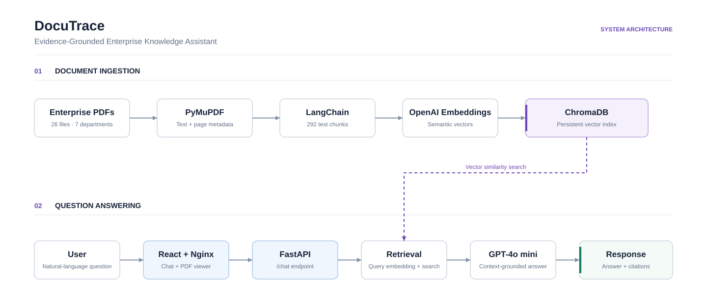

# DocuTrace

**A document-grounded RAG knowledge assistant with traceable PDF citations.**

DocuTrace lets users ask questions about an internal document collection and inspect the PDF pages behind an answer. It combines a searchable knowledge-base interface with a retrieval-augmented generation (RAG) pipeline, rather than relying on a language model's general knowledge to answer company-specific questions.

This is an independently developed portfolio implementation inspired by a real Upwork project brief. The brief described an organization seeking a question-answering assistant for approximately 80 internal PDFs. **DocuTrace uses a separate sample dataset of 26 PDFs**; it is not a commissioned deployment for that organization.

## At a glance

| | |
|---|---|
| Sample knowledge base | 26 PDFs across 7 departments |
| Indexed content | 239 pages, 292 text chunks in the tested dataset |
| Retrieval | OpenAI embeddings + ChromaDB semantic search |
| Answer generation | GPT-4o mini, conditioned on retrieved context |
| Source traceability | Document name, department, page number, and links to the original PDF |
| Application | Python/FastAPI backend, React frontend, Nginx reverse proxy |
| Deployment | Docker Compose |

## Demo

The walkthrough shows document browsing, a leave-policy question, source-page verification, an unsupported-question fallback, and the system architecture.

**Demo video:** [Add the public demo URL here after uploading the final video](#demo)

## The problem

Company knowledge often lives in separate policy files, standard operating procedures, FAQs, and technical guides. Finding an answer can mean opening multiple PDFs and manually checking whether a passage is relevant or current. A conventional chatbot may produce a plausible answer without identifying where it came from.

DocuTrace was built around three practical requirements: retrieve information from a defined document collection, show evidence for the answer, and respond clearly when the available documents do not support a question.

## What the application does

- **Document ingestion:** Extracts text from PDFs with PyMuPDF and retains source-file and page metadata.
- **Chunking and indexing:** Splits extracted text with LangChain, creates embeddings using OpenAI, and stores vectors in a persistent ChromaDB collection.
- **Semantic retrieval:** Embeds each user question and searches for relevant document chunks (top 4 in the tested configuration).
- **Context-grounded generation:** Sends retrieved context to GPT-4o mini to generate an answer based on the indexed material.
- **Source citations:** Returns document and page references, with links that open the source PDF at the cited page.
- **Knowledge-base explorer:** Provides a document list with department filtering and search.
- **Out-of-scope fallback:** Returns a defined response when the system cannot find support in the provided documents.

The fallback and citation features are safeguards, **not guarantees** that every answer or reference will be correct. Users should verify important claims against the linked source documents.

## Architecture



### 1. Indexing pipeline

```text
PDF documents
    -> PyMuPDF text extraction + document/page metadata
    -> LangChain text splitting
    -> OpenAI text-embedding-3-small
    -> Persistent ChromaDB collection
```

The sample knowledge base is organized by department. Page-level metadata is preserved so retrieved content can be traced to its originating PDF.

### 2. Question-answering pipeline

```text
User -> React UI -> Nginx /api proxy -> FastAPI
                                      |
                                      v
                          Query embedding (OpenAI)
                                      |
                                      v
                           ChromaDB retrieval
                                      |
                                      v
                         Retrieved chunks + prompt
                                      |
                                      v
                               GPT-4o mini
                                      |
                                      v
                        Answer + source references
                                      |
                                      v
                                  React UI
```

The backend coordinates retrieval and generation. ChromaDB performs vector search; GPT-4o mini receives retrieved text as context. Source references are returned separately for the UI to render as clickable PDF links.

### 3. Runtime

Docker Compose runs a frontend container (React static build served by Nginx) and a backend container (FastAPI). Nginx forwards `/api` requests to the backend. In the tested local setup, PDF documents and ChromaDB data are mounted from the host, so the index remains available after container restarts.

## Technology choices

| Layer | Technology | Responsibility |
|---|---|---|
| PDF processing | PyMuPDF | Text extraction with page information |
| Text splitting | LangChain | Chunk creation and retrieval workflow integration |
| Embeddings | OpenAI `text-embedding-3-small` | Vector representation of documents and questions |
| Vector storage | ChromaDB | Persistent similarity-search index |
| Generation | OpenAI `gpt-4o-mini` | Answer generation from retrieved context |
| Backend | Python, FastAPI | Chat, document, and knowledge-base APIs |
| Frontend | React, Vite, Tailwind CSS | Chat and document exploration UI |
| Serving | Nginx | Frontend hosting and API proxy |
| Packaging | Docker Compose | Local multi-container deployment |

## API surface

| Endpoint | Purpose |
|---|---|
| `POST /chat` | Ask a question and receive an answer with citations |
| `GET /knowledge-base` | Retrieve document-library information |
| `GET /documents/{department}/{filename}` | Open a source PDF |
| `GET /health` | Check backend availability |

The frontend reaches these routes through the Nginx `/api` proxy. See the backend source for the authoritative request and response schemas.

## Running locally

**Prerequisites:** Docker Desktop (or Docker Engine with Compose), an OpenAI API key, and an indexed document collection.

1. Clone the repository and enter its root directory.

   ```bash
   git clone https://github.com/Naveed786Ahmed/Docutrace-RAG-Platform.git
   cd Docutrace-RAG-Platform
   ```

2. Configure the backend environment using the variable names expected by the checked-in code and Compose configuration. Keep the actual `.env` file out of version control.

3. Provide the authorized PDF dataset under `sample_documents/` and generate the ChromaDB index using the ingestion entry point supplied in the backend code. **Indexing is a required setup step** if the database is not included; do not expect an empty ChromaDB directory to answer document questions.

4. Start the containers:

   ```bash
   docker compose up --build -d
   ```

5. Open **http://localhost:8080** and check the backend via the application or its health endpoint.

6. Stop the application:

   ```bash
   docker compose down
   ```

## Evaluation and observed behavior

The project has been exercised against a sample question set, including document-grounded questions and unsupported queries. Recorded development results include:

- Dense retrieval, top 4: **170 / 192** evaluated supported questions (**88.54%** in that test).
- An experimental MMR retrieval configuration: **175 / 192** (**91.15%**). This is an experiment, **not necessarily the active production query configuration**.
- A preliminary answer-level check: **18 / 20** cases passed the chosen review criteria. The remaining cases included a multi-hop answer error and a missing expected citation.
- Eight negative test questions returned the intended fallback in the recorded test.

These are **development-set observations**, not independently validated production benchmarks. Retrieval success does not by itself establish answer faithfulness or citation correctness. Evaluation data and scripts, where published under `evaluation/`, should be used to inspect the exact test methodology.

## Design decisions and trade-offs

**Page-level provenance.** Source and page metadata are retained during ingestion so a citation can point to the original file instead of a generic document title.

**Retrieval before generation.** Relevant document chunks are selected before invoking the generation model. This narrows the context but does not eliminate the possibility of an unsupported answer.

**Explicit fallback.** The assistant is instructed to decline unsupported questions. Retrieval and model behavior still need evaluation against ambiguous, conflicting, or partially supported questions.

**Persistent local index.** ChromaDB persistence allows the tested dataset to remain available across container restarts. The current deployment should be understood as a local demonstration, not a fully managed production service.

## Current scope and limitations

- The indexed corpus is a **sample enterprise dataset**, not a real organization's confidential knowledge base.
- Text extraction and retrieval quality depend on document structure; scanned PDFs may require an OCR pipeline not demonstrated here.
- Citations are intended to aid verification; they should not be treated as proof of complete factual correctness.
- The current demonstration does not establish multi-tenant authorization, document-level access controls, production monitoring, or enterprise security compliance.
- Retrieval, multi-hop reasoning, and source attribution remain areas for further testing and improvement.

---

**Project status:** Working portfolio implementation demonstrated locally. Developed independently from a public client-style problem statement.
